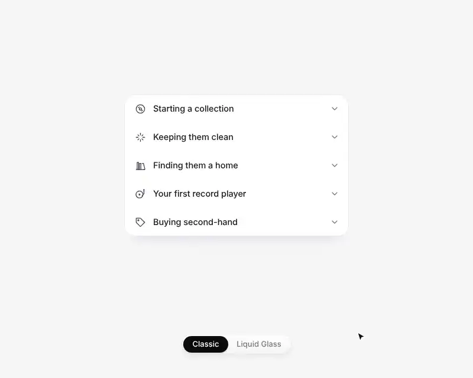

# Card Split Accordion interaction

A short guide to record collecting that starts as a single card. Open an item and the card splits into three: the items above, the open item and the items below. Gaps open up, the corners round off and the answer fades in out of a soft blur. Close it, or open another item, and the cards join back together. Classic follows the system's light or dark mode. A switch at the bottom moves between Classic and Liquid Glass.

<p align="center">
  
</p>

<p align="center"><a href="docs/demo.mp4">Watch as a video</a></p>

## Tech stack

- React 19
- Vite 8
- Tailwind CSS 4
- Each row knows whether it is a card's top or bottom edge, and CSS transitions on a spring `cubic-bezier` animate the gaps, corners and `grid-template-rows` height. No animation library
- An oversized `backdrop-filter` layer clipped by each row, so the Liquid Glass blur has no seams where rows meet

## Run

```bash
npm install
npm run dev
```
